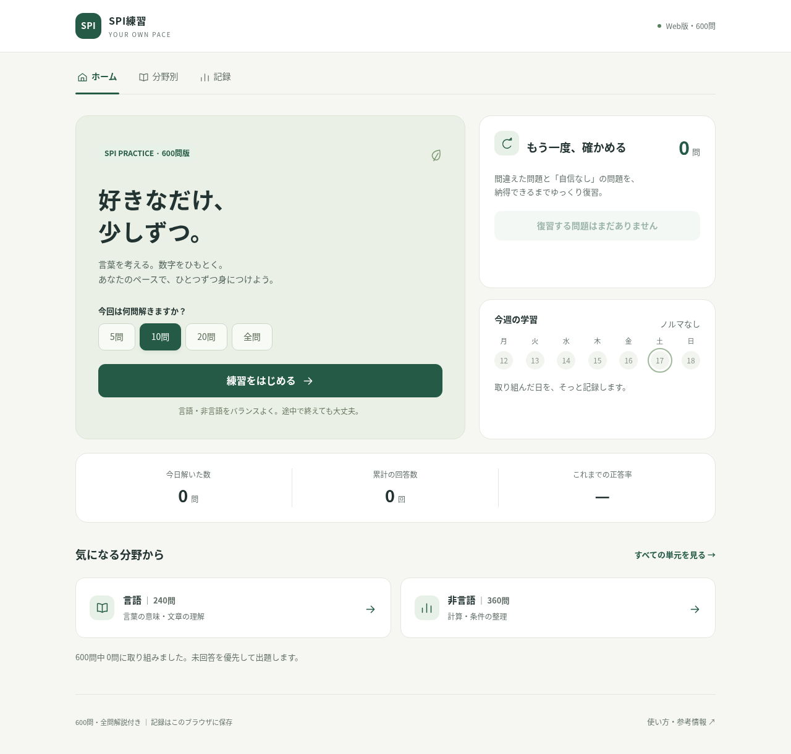
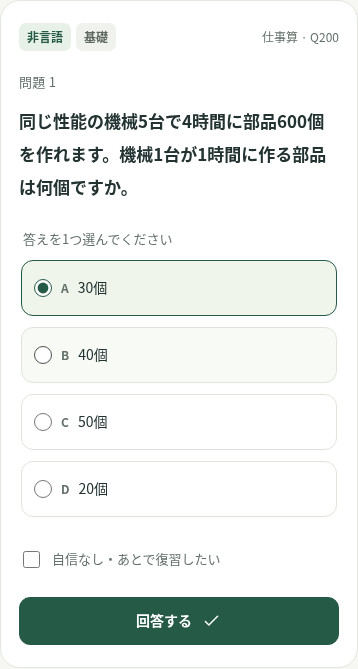
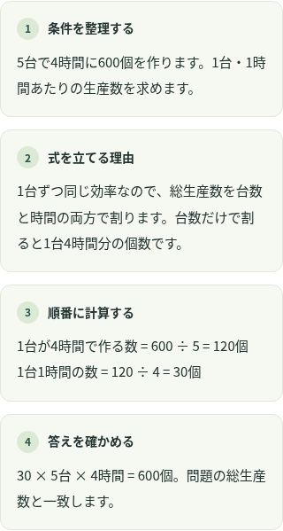

# spi-practice

自分のペースで解ける、600問のSPI練習アプリです。

**Webサイト： https://rjochi.github.io/spi-practice/**

## 画面イメージ

ホームで問題数を選び、好きなタイミングで練習を始められます。



スマートフォンでも選択肢を押しやすく、回答後は式の理由や途中計算を順に確認できます。

<p>
  
  
</p>

画像は動作確認用の学習記録を使った表示例です。

## できること

- 言語240問・非言語360問、全15単元に各40問を収録。
- 5問・10問・20問・全問から問題数を選択。
- 言語・非言語を混ぜた練習と、単元ごとの練習。
- 間違えた問題と「自信なし」の問題を復習。
- 全問解説付き。数式を使う320問には、条件整理・式の理由・途中計算・検算の4段階解説。
- 回答数・正答率・学習日をブラウザ内に保存。

時間制限や毎日のノルマはありません。オンラインでサイトを開いて使います。ログイン、端末間の同期、記録の移行、オフライン起動の機能はありません。ブラウザのデータを削除すると学習記録も消えます。

## 問題について

公開されているSPIの例題・練習資料の分野や形式を参考に、独自の題材で作成したオリジナル練習問題です。SPIの公式問題や実際の試験の過去問ではありません。公式サービスとの関係はなく、本番の得点・合否を予測するものではありません。

性格検査・英語・構造的把握力は対象外です。問題や解説に気になる点があれば、画面に表示される問題番号（Q193など）と内容を添えてIssueで報告してください。学習記録などの個人情報は投稿しないでください。

参考情報は[設計書](docs/DESIGN.md)およびアプリ内の「使い方・参考情報」に記載しています。

## 学習記録と通信

学習記録はlocalStorageに保存します。アプリには回答履歴をサーバーに送る機能やアクセス解析を組み込んでいません。別のブラウザ・端末とは記録を共有しません。

サイトの配信にはGitHub Pagesを利用しています。GitHub Pagesは配信時のアクセス情報を扱います。詳しくは[GitHubのデータ収集に関する説明](https://docs.github.com/en/pages/getting-started-with-github-pages/what-is-github-pages#data-collection)を確認してください。

## 開発

Python 3とNode.jsを使用します。アプリの実行時にこれらのインストールは不要です。

```sh
python3 build.py
python3 tests/test_questions.py
python3 tests/test_v2.py
node tests/test_core.js
```

`build.py`は`src/`をまとめ、公開用の`docs/index.html`と`docs/design.html`を生成します。検証用の問題JSONは`dist/`に出力します。問題を編集したらビルドと検証を実行し、生成された公開用ファイルもコミットしてください。

表示をローカルで確認する場合：

```sh
python3 -m http.server 8000 --directory docs
```

ブラウザで`http://localhost:8000/`を開きます。ブラウザ操作の自動検証は、PlaywrightとChromiumがある環境で`python3 tests/test_browser.py`を実行します。

## GitHub Pages

公開元は`main`ブランチの`/docs`です。設定はリポジトリの **Settings → Pages → Deploy from a branch → main /docs** で確認できます。サーバー側のアプリや有料APIは不要です。

## ライセンス

現時点ではライセンスを指定していません。Publicリポジトリであることだけで、コードや問題文の自由な再利用を許諾するものではありません。
